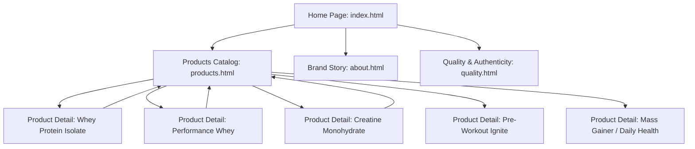

# Benchmark Analysis, Business Philosophy & Design System

## 1. Executive Summary & Context

This document captures the business philosophy, trust architecture, visual hierarchy, and design specifications derived from studying India's top three sports nutrition leaders:
1. **Optimum Nutrition India** (`optimumnutrition.co.in`) – Global gold standard, legacy, authoritative, performance-driven.
2. **Avvatar India** (`avvatarindia.com`) – Farm-to-shaker purity, fresh 100% vegetarian cow whey, vibrant modern aesthetic.
3. **MuscleBlaze** (`muscleblaze.com`) – High-energy, science-backed for Indian bodies, aggressive authenticity validation, clinical transparency.

The goal is to build an **aesthetic, legitimate, engaging, and blazing-fast Product Showcase Website** using **pure HTML & CSS** (deployable on GitHub Pages). 

### Scope Boundaries (Per User Specification)
- **Included:** Product imagery showcase, categorized catalog, detailed individual product pages, nutrition facts breakdown, quality & authenticity pillars, brand philosophy, responsive mobile-first UI.
- **Excluded (Future Phase):** No cart, no checkout, no payment gateways, no live WhatsApp/calling triggers, no contact forms.

---

## 2. Competitive Deconstruction & Key Insights

| Dimension | Optimum Nutrition (ON) | Avvatar India | MuscleBlaze (MB) | Our Showcase Website Strategy |
| :--- | :--- | :--- | :--- | :--- |
| **Brand Tone** | Authoritative, elite athlete, "Gold Standard" | Fresh, pure, direct from dairy farm, premium | Aggressive fitness, science-first, "tested for Indian bodies" | **Elite Athletic + Transparent Pure Nutrition** |
| **Color System** | Onyx black (`#111`), gold (`#D4AF37`), pure white | Deep black, vibrant golden-yellow (`#F7BC2A`), white | Pitch black, fiery orange-amber (`#FF5722`/`#FF9800`), dark charcoal | **Obsidian Black (`#0D0F12`), Pure White (`#FFFFFF`), Athletic Gold/Electric Amber (`#FFB800` / `#E69500`)** |
| **Hero Pitch** | "World's #1 Selling Whey" | "100% Fresh Cow Whey / 24-hr Processing" | "Clinically Tested / Labdoor Certified" | **Clean, pure formulation, transparent macros, uncompromising quality** |
| **Product Card Formula** | Image + Title + Weight/Flavor + Key Macros badge | Image + Product Title + Tagline + Badges | High-contrast image + Variant summary + Discount/Price + Lab badges | **Hero Image + Category Tag + Product Title + Key Macro Highlights (e.g. 25g Protein, 5.5g BCAA) + "Explore Details →"** |
| **Product Detail Strategy** | Big tub visual, flavor chooser, full amino profile table | High-res renders, benefit icons, scoop directions | Clinical absorption stats (50% higher), Labdoor verification, detailed FAQs | **Rich Hero Gallery, Macro Pill Badges, Detailed Nutrition Facts Table, Usage Directions, Authenticity Pillars** |

---

## 3. Core Business Idea & Philosophy

### A. The "Trust & Legitimacy" Imperative
In sports nutrition and bodybuilding supplements, the #1 barrier for consumers is **authenticity and label honesty**. Customers fear adulterated or duplicate protein powders. To appear 100% legitimate and premium without a complex backend, the website will embody the following pillars:

1. **Certified Quality Badges**:
   - 100% Authentic Guaranteed
   - Sourced from Premium Ingredients (Zero Banned Substances)
   - Certified Manufacturing (GMP & ISO standards)
   - Third-Party Tested (NABL / Lab Accredited specs)
2. **Radical Macro Transparency**:
   - Prominently feature the exact protein percentage per serving.
   - Show the full amino acid profile (EAAs, BCAAs, Glutamic Acid).
   - Clear disclosure of zero added sugars, trans fats, or filler maltodextrin.
3. **Transparent Product Provenance**:
   - Clear batch testing philosophy.
   - Manufacturing standards & clean storage recommendations.
4. **Educational & Goal-Driven Presentation**:
   - Help users understand *why* this product fits their fitness goals (Muscle Gain, Lean Definition, Athletic Stamina, Daily Recovery).

---

## 4. Information Architecture & Page Hierarchy



### 1. Home Page (`index.html`)
- **Top Announcement Bar:** Brand trust announcement (e.g., *"100% Authentic Quality Tested Formulations | Direct Manufacturer Showcase"*).
- **Navigation Header:** Logo, Navigation Links (*Home, All Products, Categories, Quality & Lab Standards, About Us*).
- **Hero Section:** High-impact athlete/tub imagery with bold headline (e.g., *"Engineered for Peak Performance"*), key value props, and "Explore Range" CTA button.
- **Trust Indicators Bar:** 4 quick visual trust badges (100% Genuine, Pure Sourced, Zero Fillers, Rigorous Testing).
- **Featured Categories Strip:** Quick-jump cards (Whey Proteins, Mass Gainers, Pre-Workout, Performance & Recovery).
- **Flagship / Best-Selling Product Grid:** 4-6 flagship product cards with image, product title, macro highlights, and "View Product Details" link.
- **Science / Quality Spotlight Section:** Visual diagram explaining formulation quality, absorption rate, and clean ingredients.
- **Target Audience / Goal Selector:** Beginner, Muscle Building, Lean Cut, Endurance.
- **Customer / Athlete Showcase:** Quotes & testimonials focusing on taste, mixability, and real results.
- **Footer:** Brand mission, quick navigation links, certifications notice, copyright.

### 2. Products Catalog Page (`products.html`)
- **Header & Category Pill Filters:** Pure CSS / semantic tabs allowing users to browse All, Proteins, Performance/Pre-Workout, Gainers, Daily Essentials.
- **Product Showcase Grid:** Clean, responsive 3-column / 4-column grid of all products.
- **Product Card Anatomy:**
  - Product Image with smooth hover zoom
  - Category Badge (e.g., `Whey Isolate`, `Performance`)
  - Product Title (e.g., `Pro Gold 100% Whey Isolate`)
  - Subtitle / Flavor / Serving Size indicator
  - Macro Highlights Bar: `27g Protein` | `6.2g BCAA` | `0g Added Sugar`
  - "View Full Specs →" CTA leading directly to that product's detail page.

### 3. Individual Product Detail Pages (`products/[product-slug].html`)
- **Breadcrumbs:** `Home > Products > [Category] > [Product Name]`
- **Product Showcase Two-Column Hero:**
  - **Left Column:** High-resolution product images, packaging front/back renders, flavor badge.
  - **Right Column:**
    - Category Tag & Status badge ("100% Pure Formula")
    - Full Product Title & Tagline
    - Key Macro Highlight Pills (Protein per scoop, BCAA, Serving Size, Calories)
    - Available Sizes & Flavors (informational badges, e.g., "Available in 1kg, 2kg" | "Rich Chocolate, Café Mocha")
    - Quick Product Highlights bullet points
- **Interactive Information Tabs / Accordions:**
  - **Overview & Benefits:** What makes this formula unique, who it's for, and expected athletic benefits.
  - **Nutrition Facts & Amino Acid Profile:** Detailed tabular data (per 100g and per serving) including macro-nutrients and amino acid spectrum.
  - **Ingredients & Purity:** Complete list of raw materials, digestive enzyme blend, allergen statements.
  - **How to Consume / Directions:** 3-step visual guide (1 Scoop + 250ml Water + Shake 30s + Best Time: Post-Workout).
- **Authenticity & Quality Seal Section:** Explains how purity is tested, GMP certification, and batch verification.
- **Related Products Carousel / Grid:** 3 related supplements to keep browsing engaging.

### 4. Quality & Brand Story Pages (`about.html`, `quality.html`)
- Explains the brand philosophy, raw material sourcing standards, testing protocols, and commitment to clean sports nutrition.

---

## 5. Design System & Visual Specification

### Color Palette (Athletic Luxury & High Energy)
```css
:root {
  /* Primary Brand Colors */
  --color-bg-primary: #0C0E12;       /* Deep charcoal-black background */
  --color-bg-secondary: #141820;     /* Elevated surface / card background */
  --color-bg-tertiary: #1C222E;      /* Hover states & borders */
  --color-bg-light: #F8F9FA;         /* For light containers if needed */

  /* Accent & Highlight Colors */
  --color-accent-gold: #FFB800;      /* Primary energetic gold/amber */
  --color-accent-gold-hover: #E6A500;
  --color-accent-orange: #FF5A1F;    /* Pre-workout / high energy accent */
  --color-accent-cyan: #00E5FF;      /* Hydration / Isolate accent */

  /* Text & Neutral Colors */
  --color-text-primary: #FFFFFF;     /* Crisp white headings */
  --color-text-secondary: #CBD5E1;   /* Muted light gray for readable paragraphs */
  --color-text-muted: #94A3B8;       /* Subtle meta-data, breadcrumbs, borders */
  
  /* Borders & Shadows */
  --color-border: rgba(255, 255, 255, 0.08);
  --color-border-accent: rgba(255, 184, 0, 0.3);
  --shadow-card: 0 10px 30px -10px rgba(0, 0, 0, 0.5);
  --shadow-glow: 0 0 20px rgba(255, 184, 0, 0.15);
}
```

### Typography Scale
- **Display Font (Headings, Badges, Big Numbers):** Condensed, athletic, bold sans-serif. Recommended: `'Montserrat', 'Oswald', sans-serif` or modern system bold (`system-ui, -apple-system, BlinkMacSystemFont, "Segoe UI", Roboto`).
- **Body Font:** Modern, highly legible neutral sans-serif: `'Inter', -apple-system, sans-serif`.
- **Typographic Scale:**
  - Hero Headline: `clamp(2.5rem, 5vw, 4rem)` (40px–64px, bold uppercase, tight letter spacing `-0.02em`)
  - Section Titles: `clamp(1.75rem, 3.5vw, 2.5rem)` (28px–40px)
  - Card Titles: `1.25rem` (20px, semi-bold)
  - Body Text: `1rem` (16px, line-height 1.6, comfortable readability)
  - Microcopy / Badges: `0.75rem - 0.85rem` (12px–13.6px, uppercase tracking `0.05em`)

### Component Library Specs (Pure CSS)
1. **Product Card Component**:
   - Dark elevated background with 1px subtle border.
   - Smooth transform on hover (`transform: translateY(-6px)` + glow shadow).
   - High-contrast macro bar: pill shaped with high-contrast text.
   - Image wrapper with fixed aspect-ratio (`4 / 3` or `1 / 1`) with object-fit contain.
2. **Nutrition Facts Table Component**:
   - Styled after official supplement facts panels.
   - Clean alternating row backgrounds, crisp borders, bold macro headers.
3. **Trust Badge Component**:
   - Flex container with SVG icon, title, and descriptive snippet.
4. **Responsive Mobile Strategy**:
   - Seamless hamburger navigation on screens < 768px.
   - 1-column layout on mobile, 2-column on tablet (768px+), 3/4-column on desktop (1024px+).
   - Touch-friendly tap targets (> 44px).

---

## 6. Performance & GitHub Pages Readiness

- **Zero JavaScript framework overhead**: No React, Vue, or heavy dependencies. Zero build-step requirement.
- **Pure CSS3**: Hand-crafted CSS using CSS variables, Flexbox, and CSS Grid.
- **Image Optimization Guidance**: All product images will be formatted as modern WebP / optimized PNG with explicit `width`, `height`, and `loading="lazy"` attributes.
- **Directory Structure for GitHub Pages**:
  - Root `index.html` serves as the entry point.
  - Subpages like `products.html`, `about.html`, and `products/*.html` link cleanly using relative paths.
