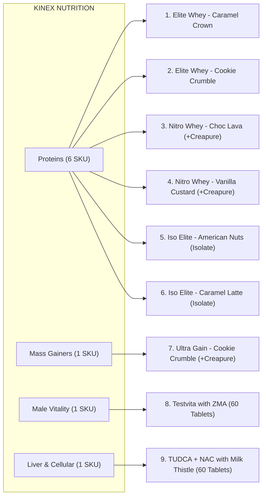

# KINEX NUTRITION - Verified Official Product Master Database

This document represents the **authoritative, verified product specifications** compiled from:
1. High-resolution packaging renders in `~/Documents/product-photo`
2. Official product specification sheets in `~/Documents/product-pdf`

Every macro, active ingredient milligram, serving size, amino acid breakdown, and instruction is verified for accuracy.

---

## Brand Identity & Corporate Credentials
- **Brand Name:** **KINEX NUTRITION**
- **Brand Positioning:** Ultra-Premium Sports Nutrition & Advanced Cellular Health Formulations
- **Headquarters & Manufacturing Address:** B 1350, Orleans St, Floor 8, Chicago, IL 60654 USA
- **Official Website:** `www.kinexnutrition.com`
- **Customer Care Email:** `info@kinexnutrition.com`
- **Quality Seal & Formulations Guarantee:**
  - 100% Genuine Formula
  - Zero Amino Spiking / No Fillers
  - Powered by Creapure® German Creatine Monohydrate (where indicated)
  - 200mg–400mg Digestive Enzyme Complex for optimal GI absorption
  - Dietary Supplements manufactured under strict GMP & FDA compliance

---

## Master Catalog: Complete Verified Product Specifications

### Category 1: Ultra-Premium Proteins

---

### Product 1: Kinex Elite Whey - Caramel Crown
* **Product Code / Slug:** `elite-whey-caramel-crown`
* **Category:** 100% Whey Protein
* **Net Weight:** 5 LBS (2.27 KG)
* **Serving Size:** 1 Scoop (32 g)
* **Servings Per Container:** 70 Servings
* **Flavor Profile:** Caramel Crown
* **Packaging Images:**
  - Front Pack: `assets/images/products/1-elite-whey-caramel-crown-front.webp`
  - Nutrition Label: `assets/images/products/1-elite-whey-caramel-crown-nutrition.webp`
  - Back Story: `assets/images/products/1-elite-whey-caramel-crown-back.webp`

#### Nutrition Facts (Per 32g Serving)
| Nutrient | Amount Per Serving | % Daily Value* |
| :--- | :--- | :--- |
| **Calories** | 120 | – |
| **Total Fat** | 1.4 g | 2% |
| - Saturated Fat | 0.4 g | 2% |
| - Trans Fat | 0 g | † |
| **Cholesterol** | 10 mg | 3% |
| **Total Carbohydrate** | 1.5 g | 1% |
| - Dietary Fiber | 0 g | 0% |
| - Total Sugars | 0.5 g | † |
| - Includes Added Sugars | 0 g | 0% |
| **Protein** | **24 g** | **48%** |
| Sodium | 150 mg | 7% |
| Calcium | 120 mg | 9% |
| Iron | 0.2 mg | 1% |
| Potassium | 200 mg | 4% |
| **Digestive Enzyme Blend** | **200 mg** | † |

*\*Percent Daily Values are based on a 2,000 calorie diet. †Daily Value not established.*

#### Amino Acid Profile (Amount Per 32g Serving / Per 100g)
* **Branched Chain Amino Acids (BCAAs):** 5.00 g / 15.63 g
* **Essential Amino Acids (EAAs):** 10.95 g / 34.22 g
* **Conditionally Essential Amino Acids:** 3.44 g / 10.75 g
* **Non-Essential Amino Acids:** 9.61 g / 30.03 g
* **Total Amino Acids:** 24.00 g / 75.00 g

#### Ingredients & Allergens
* **Ingredients:** Whey Protein Concentrate, Whey Protein Isolate, Milk Protein Concentrate, Natural and Artificial Flavors, Sunflower Lecithin, Sucralose, Maltodextrin, Xanthan Gum, Acesulfame Potassium, Digestive Enzyme Blend.
* **Allergen Information:** Contains Milk & Soy.
* **Directions for Use:** Add 1 scoop (32 g) to 6–8 fl oz of cold water, milk, or your preferred beverage. Shake or blend for 25–30 seconds until thoroughly mixed. Use after training, between meals, or anytime additional dietary protein is required.

---

### Product 2: Kinex Elite Whey - Cookie Crumble Pop
* **Product Code / Slug:** `elite-whey-cookie-crumble`
* **Category:** 100% Whey Protein
* **Net Weight:** 5 LBS (2.27 KG)
* **Serving Size:** 1 Scoop (32 g) | **Servings Per Container:** 70 Servings
* **Flavor Profile:** Cookie Crumble Pop
* **Packaging Images:**
  - Front Pack: `assets/images/products/2-elite-whey-cookie-crumble-front.webp`
* **Specifications:** Shares the verified 24g Protein, 5g BCAA, 120 Calorie formula of Elite Whey with an indulgent cookie crumble flavor profile. Zero added sugars and digestive enzymes included.

---

### Product 3: Kinex Nitro Whey + Creapure® - Chocolate Lava Cake
* **Product Code / Slug:** `nitro-whey-chocolate-lava`
* **Category:** Blend Whey Protein + German Creatine
* **Net Weight:** 5 LBS (2.27 KG)
* **Serving Size:** 1 Scoop (32 g)
* **Servings Per Container:** 70 Servings
* **Flavor Profile:** Chocolate Lava Cake
* **Packaging Images:**
  - Front Pack: `assets/images/products/3-nitro-whey-chocolate-lava-front.webp`
  - Nutrition Label: `assets/images/products/3-nitro-whey-chocolate-lava-nutrition.webp`
  - Back Story: `assets/images/products/3-nitro-whey-chocolate-lava-back.webp`

#### Nutrition Facts (Per 32g Serving)
| Nutrient | Amount Per Serving | % Daily Value* |
| :--- | :--- | :--- |
| **Calories** | 110 | – |
| **Total Fat** | 1.4 g | 2% |
| - Saturated Fat | 0.4 g | 2% |
| - Trans Fat | 0 g | † |
| **Cholesterol** | 10 mg | 3% |
| **Total Carbohydrate** | 1.5 g | 1% |
| - Dietary Fiber | 0 g | 0% |
| - Total Sugars | 0.5 g | † |
| - Includes Added Sugars | 0 g | 0% |
| **Protein** | **23 g** | **44%** |
| **Creatine Monohydrate (Creapure®)** | **3 g** | † |
| Sodium | 150 mg | 7% |
| Calcium | 120 mg | 9% |
| Potassium | 200 mg | 4% |
| **Digestive Enzyme Blend** | **200 mg** | † |

#### Amino Acid Profile (Amount Per 32g Serving / Per 100g)
* **Branched Chain Amino Acids (BCAAs):** 4.80 g / 14.97 g
* **Essential Amino Acids (EAAs):** 10.49 g / 32.79 g
* **Conditionally Essential Amino Acids:** 3.30 g / 10.30 g
* **Non-Essential Amino Acids:** 9.21 g / 28.78 g
* **Total Amino Acids:** 23.00 g / 71.88 g

#### Ingredients & Allergens
* **Ingredients:** Whey Protein Concentrate, Whey Protein Isolate, Milk Protein Concentrate, Soy Protein Concentrate, Creatine Monohydrate (Creapure®), Natural and Artificial Flavors, Sunflower Lecithin, Sucralose, Maltodextrin, Xanthan Gum, Acesulfame Potassium, Digestive Enzyme Blend.
* **Allergen Information:** Contains Milk and Soy.
* **Directions for Use:** Add 1 scoop (32 g) to 6–8 fl oz of cold water, milk, or beverage of choice. Shake or blend for 25–30 seconds. Ideal for post-workout muscle recovery and strength building.

---

### Product 4: Kinex Nitro Whey + Creapure® - Vanilla Custard
* **Product Code / Slug:** `nitro-whey-vanilla-custard`
* **Category:** Blend Whey Protein + German Creatine
* **Net Weight:** 5 LBS (2.27 KG)
* **Serving Size:** 1 Scoop (32 g) | **Servings Per Container:** 70 Servings
* **Flavor Profile:** Vanilla Custard
* **Packaging Images:**
  - Front Pack: `assets/images/products/4-nitro-whey-vanilla-custard-front.webp`
* **Specifications:** 23g Protein, 3g Creapure® Creatine Monohydrate, 4.8g BCAA, 110 Calories, 200mg Digestive Enzymes.

---

### Product 5: Kinex Iso Elite - American Nuts Cream
* **Product Code / Slug:** `iso-elite-american-nuts`
* **Category:** 100% Whey Protein Isolate
* **Net Weight:** 5 LBS (2.27 KG)
* **Serving Size:** 1 Scoop (32 g)
* **Servings Per Container:** 70 Servings
* **Flavor Profile:** American Nuts Cream
* **Packaging Images:**
  - Front Pack: `assets/images/products/5-iso-elite-american-nuts-front.webp`
  - Nutrition Label: `assets/images/products/5-iso-elite-american-nuts-nutrition.webp`
  - Back Story: `assets/images/products/5-iso-elite-american-nuts-back.webp`

#### Nutrition Facts (Per 32g Serving)
| Nutrient | Amount Per Serving | % Daily Value* |
| :--- | :--- | :--- |
| **Calories** | 105 | – |
| **Total Fat** | 1.2 g | 2% |
| - Saturated Fat | 0.4 g | 2% |
| - Trans Fat | 0 g | † |
| **Cholesterol** | 10 mg | 3% |
| **Total Carbohydrate** | 1.5 g | 1% |
| - Dietary Fiber | 0 g | 0% |
| - Total Sugars | 0.5 g | † |
| - Includes Added Sugars | 0 g | 0% |
| **Protein** | **26 g** | **52%** |
| Sodium | 150 mg | 7% |
| Calcium | 120 mg | 9% |
| Potassium | 200 mg | 4% |
| **Digestive Enzyme Blend** | **200 mg** | † |

#### Amino Acid Profile (Amount Per 32g Serving / Per 100g)
* **Branched Chain Amino Acids (BCAAs):** 5.50 g / 17.50 g
* **Essential Amino Acids (EAAs):** 11.86 g / 37.02 g
* **Conditionally Essential Amino Acids:** 3.74 g / 11.65 g
* **Non-Essential Amino Acids:** 10.41 g / 32.03 g
* **Total Amino Acids:** 26.00 g / 81.25 g

#### Ingredients & Allergens
* **Ingredients:** Whey Protein Concentrate, Whey Protein Isolate, Milk Protein Concentrate, Natural and Artificial Flavors, Sunflower Lecithin, Sucralose, Maltodextrin, Xanthan Gum, Acesulfame Potassium, Digestive Enzyme Blend.
* **Allergen Information:** Contains Milk & Soy.
* **Directions for Use:** Add 1 scoop (32 g) to 6–8 fl oz of cold water or milk. Shake 25–30 seconds. Formulated for athletes demanding maximum protein purity with ultra-low calories.

---

### Product 6: Kinex Iso Elite - Caramel Latte
* **Product Code / Slug:** `iso-elite-caramel-latte`
* **Category:** 100% Whey Protein Isolate
* **Net Weight:** 5 LBS (2.27 KG)
* **Serving Size:** 1 Scoop (32 g) | **Servings Per Container:** 70 Servings
* **Flavor Profile:** Caramel Latte
* **Packaging Images:**
  - Front Pack: `assets/images/products/6-iso-elite-caramel-latte-front.webp`
* **Specifications:** 26g Pure Protein, 5.5g BCAA, 105 Calories, Zero Added Sugar, Barista-Grade Caramel Latte flavor.

---

### Category 2: Mass & High-Calorie Gainers

---

### Product 7: Kinex Ultra Gain + Creapure® - Cookie Crumble
* **Product Code / Slug:** `ultra-gain-cookie-crumble`
* **Category:** Premium Mass Gainer
* **Net Weight:** 6 LBS (2.72 KG)
* **Serving Size:** 1 Scoop (100 g)
* **Servings Per Container:** 27 Servings
* **Flavor Profile:** Cookie Crumble
* **Packaging Images:**
  - Front Pack: `assets/images/products/7-ultra-gain-cookie-crumble-front.webp`
  - Nutrition Label: `assets/images/products/7-ultra-gain-cookie-crumble-nutrition.webp`
  - Back Story: `assets/images/products/7-ultra-gain-cookie-crumble-back.webp`

#### Nutrition Facts (Per 100g Serving)
| Nutrient | Amount Per Serving | % Daily Value* |
| :--- | :--- | :--- |
| **Calories** | **380** | – |
| **Total Fat** | 8 g | 10% |
| - Saturated Fat | 2 g | 10% |
| - Trans Fat | 0 g | † |
| **Cholesterol** | 2 mg | 1% |
| **Total Carbohydrate** | **56 g** | **20.75%** |
| - Dietary Fiber | 2 g | 7% |
| - Total Sugars | 5 g | † |
| - Includes Added Sugars | 0 g | 0% |
| **Protein** | **15 g** | **30%** |
| Sodium | 150 mg | 7% |
| Vitamin D | 2.5 mcg (100 IU) | 13% |
| Vitamin B6 | 10 mg | 588% |
| Vitamin B12 | 200 mcg | 8,333% |
| Calcium | 200 mg | 15% |
| Iron | 5 mg | 28% |
| Magnesium | 100 mg | 24% |
| Zinc | 1 mg | 9% |
| Potassium | 200 mg | † |
| **Creatine Monohydrate (Creapure®)** | **3 g** | † |
| **Digestive Enzyme Blend** | **400 mg** | † |

#### Ingredients & Allergens
* **Ingredients:** Protein Complex (Whey Protein Concentrate, Micellar Casein, Milk Protein Concentrate, Whey Protein Isolate, Soy Protein Concentrate), Maltodextrin, Silicone Dioxide, Creatine Monohydrate, Vitamins, Calcium, Iron, Magnesium, Zinc, Sodium, Potassium, Natural & Artificial Flavors, Sucralose.
* **Allergen Information:** Contains Milk & Soy.
* **Directions for Use:** Add 1 scoop (100 g) to 10–12 fl oz of cold water or milk. Shake 25–30 seconds. Consume post-workout or between meals. For hard-gainers, take up to 2 servings daily.

---

### Category 3: Male Vitality & Optimization

---

### Product 8: Kinex Testvita With ZMA - Natural Testo Optimizer
* **Product Code / Slug:** `testvita-vitality`
* **Category:** Daily Male Vitality & Testo Support
* **Format:** 60 Dietary Tablets
* **Serving Size:** 2 Tablets Daily
* **Servings Per Container:** 30 Servings
* **Packaging Images:**
  - Front Pack: `assets/images/products/8-testvita-vitality-front.webp`
  - Nutrition Label: `assets/images/products/8-testvita-vitality-nutrition.webp`
  - Back Story: `assets/images/products/8-testvita-vitality-back.webp`

#### Supplement Facts & Active Complexes (Per 2 Tablets)
| Complex | Amount Per Serving | Key Ingredients & Actives |
| :--- | :--- | :--- |
| **Vitamins, Minerals & Antioxidant Complex** | **1300 mg** | Vitamins A, C, D3, E, K2, B1, B2, B3, B5, B6, Biotin, Folate, B12, Calcium, Magnesium, Zinc, Iodine, Copper, Manganese, Selenium, Chromium, Molybdenum, Potassium, Phosphorus, Chloride, Boron, Iron, Choline, Green Tea Extract, Hawthorn Berries, Bilberry Fruit, Grape Seed Extract, Black Currant Extract, NAC, DHA/EPA, Curcumin, Milk Thistle. |
| **Testosterone & Male Vitality Complex** | **1400 mg** | Ashwagandha Root Extract, Fenugreek Seed Extract, Purified Shilajit Extract, Tongkat Ali Root Extract, Panax Ginseng Root, Safed Musli Root, Tribulus Terrestris Fruit, Ginger Root, Saffron, Beetroot, Pomegranate, Pine Bark Extract, Grape Extract, Wild Yam, L-Dopa, Maca, Phosphatidic Acid. |
| **Neuro Focus Complex** | **600 mg** | Panax Ginseng Root, 5-HTP (5-Hydroxytryptophan), Bacopa Monnieri, Valerian Root, Nardostachys Jatamansi. |

#### Other Ingredients & Directions
* **Other Ingredients:** Microcrystalline Cellulose, Croscarmellose Sodium, Magnesium Stearate, Stearic Acid, Hydroxypropyl Methylcellulose.
* **Directions for Use:** Take two tablets daily after a meal with plenty of water, or as recommended by your healthcare professional. Do not exceed recommended dosage.

---

### Category 4: Liver & Cellular Detoxification

---

### Product 9: Kinex TUDCA + NAC with Milk Thistle
* **Product Code / Slug:** `tudca-nac-liver-support`
* **Category:** Antioxidant, Liver & Cellular Support
* **Format:** 60 Dietary Tablets
* **Serving Size:** 2 Tablets Daily
* **Servings Per Container:** 30 Servings
* **Packaging Images:**
  - Front Pack: `assets/images/products/9-tudca-nac-liver-support-front.webp`
  - Nutrition Label: `assets/images/products/9-tudca-nac-liver-support-nutrition.webp`
  - Back Story: `assets/images/products/9-tudca-nac-liver-support-back.webp`

#### Supplement Facts (Per 2 Tablets)
| Active Ingredient | Amount Per Serving | % Daily Value* |
| :--- | :--- | :--- |
| **TUDCA (Tauroursodeoxycholic Acid)** | **300 mg** | † |
| **NAC (N-Acetyl-L-Cysteine)** | **300 mg** | † |
| **Milk Thistle Extract (Silybum marianum)** | **280 mg – 300 mg** | † |
| **Dandelion Root Extract** | **200 mg** | † |
| **Vitamin C** | **100 mg** | 111% |
| **SAMe (S-Adenosyl-L-Methionine)** | **100 mg** | † |
| **Quercetin** | **100 mg** | † |
| **Curcumin (from Turmeric Root)** | **100 mg** | † |
| **Glutathione (Master Antioxidant)** | **100 mg** | † |
| **Vitamin E** | **20 mg** | 133% |
| **Artichoke Extract (Cynara scolymus)** | **50 mg** | † |
| **TMG (Trimethylglycine)** | **50 mg** | † |
| **Selenium (as Selenomethionine)** | **30 mcg** | 55% |

#### Other Ingredients & Directions
* **Other Ingredients:** Microcrystalline Cellulose, Croscarmellose Sodium, Magnesium Stearate, Stearic Acid, Hydroxypropyl Methylcellulose.
* **Directions for Use:** Take one tablet twice daily — one in the morning and one in the evening, preferably after meals, or as advised by your healthcare professional.

---

## Catalog Mapping Summary

